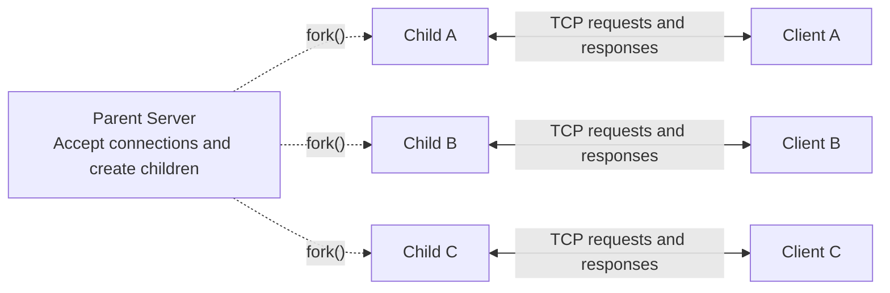

# Network and System Programming Midterm

[Traditional Chinese documentation](README_zh.md)

This project is a **fork-per-client system information service** written in C. After accepting a TCP connection, the server calls `fork()` to create a separate child process for that client. Clients can test connectivity, request information about the server's computer, or request a delayed response to demonstrate concurrent processing.

The project builds directly with the local `gcc`/Apple Clang compiler and Makefile. macOS and Linux share the same source code; the Makefile selects the appropriate shared-library options for each platform.

## 1. Assignment Requirements

| Requirement | Implementation | Verification |
|---|---|---|
| One forked child per client | The parent calls `fork()` after each `accept()` | Server logs and `ps` show distinct child PIDs |
| At least 10 concurrent clients | Ten clients run `DELAY 3` simultaneously | `make concurrency-test` |
| Compile-time debug control | `ENABLE_DEBUG` macro | `make release` / `make debug` |
| Runtime debug control | `--log-level error\|info\|debug` | Change server/client options |
| Dynamic shared library | `libnetutil.so` | `otool -L` on macOS; `ldd` on Linux |
| Client requests system information | `sysinfo` command | Hostname, OS, kernel, CPU, memory, and more |
| Robustness | Complete I/O, timeouts, signals, and input validation | `make robustness-test` |
| At least three comparisons with and without robustness | Fragmentation, timeout, and zombie tests | Compare `server_baseline` with the robust server |
| Makefile build | One Makefile for macOS and Linux | `make`, `make debug`, `make test` |

The demonstration video has not been produced yet. Actual packet capture is deferred for a later Wireshark demonstration.

## 2. System Architecture



Dashed arrows show the parent creating child processes with `fork()`. Solid bidirectional arrows show TCP communication between each client and its assigned child.

The parent first accepts each connection with `accept()`, then calls `fork()`. The child inherits the connected socket, so the client does not reconnect. The parent closes its copy of that socket and continues accepting other clients; requests and responses are handled by the child.

The parent process:

1. Creates the listening socket.
2. Accepts a new connection with `accept()`.
3. Creates a child with `fork()`.
4. Closes its copy of the connected client socket.
5. Continues accepting clients.
6. Reaps exited children through a `SIGCHLD` handler and `waitpid(..., WNOHANG)`.

Each child process:

1. Closes its copy of the listening socket.
2. Sets timeouts on the connected client socket.
3. Receives and validates one request.
4. Performs the requested operation and sends a response.
5. Closes the connection and terminates with `_exit()`.

Each connection handles one request. This keeps the child lifecycle clear and makes process concurrency easy to observe.

## 3. Files and Source Code

```text
midterm/
├── Makefile
├── README.md                  # English documentation
├── README_zh.md               # Traditional Chinese documentation
├── include/
│   ├── netutil.h              # Network I/O, timeouts, logging, validation APIs
│   └── protocol.h             # Request/response message format API
├── src/
│   ├── netutil.c              # send_all, recv_line, recv_exact, debug logging
│   ├── protocol.c             # Command parsing and length-prefixed framing
│   ├── server.c               # Sockets, fork, signals, system information
│   └── client.c               # Client CLI, connections, diagnostic modes
├── tests/
│   ├── concurrency_test.sh
│   ├── robustness_demo.sh     # Runs the following three tests in sequence
│   ├── robustness_fragment.sh # TCP request fragmentation
│   ├── robustness_timeout.sh  # Idle-client timeout
│   ├── robustness_zombie.sh   # Zombie-process reaping
│   └── test_logging.sh        # Shared console and test-log output helpers
└── docs/
    └── requirements.md         # Complete assignment requirements
```

Build outputs:

```text
build/release/bin/server
build/release/bin/server_baseline
build/release/bin/client
build/release/lib/libnetutil.so

build/debug/bin/server
build/debug/bin/server_baseline
build/debug/bin/client
build/debug/lib/libnetutil.so
```

`netutil.c` and `protocol.c` are compiled into the dynamic shared library. The client and both server variants link against the same `libnetutil.so`, sharing network I/O, protocol parsing, and logging implementations.

## 4. Features

### `ping`

Checks connectivity and protocol handling:

```text
Request:  REQUEST PING\n
Response: OK 5\nPONG\n
```

### `sysinfo`

Returns information about the server's computer:

- Hostname
- OS name
- Kernel version
- CPU architecture
- Number of online CPUs
- Total physical memory in MiB
- Uptime in seconds
- Server local time
- PID of the child handling the request

### `delay N`

The child waits `N` seconds before replying. `N` must be between 0 and 10. This command is used for the 10-client concurrency demonstration.

## 5. Message Format

Requests start with the word `REQUEST`, followed by the command on the same line:

```text
REQUEST PING\n
REQUEST SYSINFO\n
REQUEST DELAY 3\n
```

Successful response:

```text
OK <payload_bytes>\n
<payload>
```

Error response:

```text
ERR <status_code> <payload_bytes>\n
<error_message>
```

Example:

```text
ERR 400 16\n
invalid request\n
```

Length prefixes are necessary because TCP is a byte stream: a single `read()` does not necessarily return one complete application message. The client reads the header first, then receives the specified number of payload bytes.

## 6. Prerequisites

- macOS or Linux
- `gcc`, `clang`, or a compatible C compiler
- `make`
- POSIX sockets, `fork()`, and signal APIs

On the Mac used for verification, `/usr/bin/gcc` is Apple Clang. It can compile this project successfully.

## 7. Building

Enter the project directory:

```bash
cd midterm
```

Build the release server and client, then the baseline server:

```bash
make
make baseline
```

Alternatively, build all three release executables with one command:

```bash
make release
```

Build a version containing debug logging code:

```bash
make debug
```

Display the detected build configuration:

```bash
make print-config
```

Remove all build artifacts:

```bash
make clean
```

### Shared-library differences on macOS and Linux

- macOS uses `-dynamiclib` to produce a Mach-O dynamic library named `libnetutil.so`.
- Linux uses `-shared -fPIC` to produce an ELF shared object.
- Both platforms use a relative runtime library search path (rpath), so no manual `DYLD_LIBRARY_PATH` or `LD_LIBRARY_PATH` setting is required.

## 8. Running the Application

Open the first terminal and start the server:

```bash
cd midterm
./build/release/bin/server
```

The default listening endpoint is:

```text
127.0.0.1:9090
```

Open a second terminal and run the client:

```bash
cd midterm
./build/release/bin/client ping
./build/release/bin/client sysinfo
./build/release/bin/client delay 3
```

Example `sysinfo` output from a verified run:

```text
hostname: Yn-MacBook-Air.local
os: Darwin
kernel: 27.0.0
architecture: arm64
cpu_online: 10
memory_total_mib: 24576
uptime_seconds: 2534393
server_time: 2026-11-06 19:42:54 +0800
child_pid: 34477
```

Press `Ctrl+C` to stop the parent server.

### Custom host and port

Server:

```bash
./build/release/bin/server --bind 127.0.0.1 --port 10000
```

Client:

```bash
./build/release/bin/client --host 127.0.0.1 --port 10000 sysinfo
```

### Connecting between two computers

Make the server listen on all IPv4 interfaces:

```bash
./build/release/bin/server --bind 0.0.0.0 --port 9090
```

On the other computer, connect to the server's LAN IP address:

```bash
./build/release/bin/client --host 192.168.1.10 --port 9090 sysinfo
```

The two computers must be able to reach each other, and the firewall must allow TCP port 9090.

## 9. Two-Level Debug Logging

### Release vs. Debug

Both builds provide the same application features. Debug is intended for development and troubleshooting; Release enables compiler optimization.

| Item | **Release (`release`)** | **Debug (`debug`)** |
|---|---|---|
| Build command | `make release` | `make debug` |
| Output directory | `build/release/` | `build/debug/` |
| Server executable | `./build/release/bin/server` | `./build/debug/bin/server` |
| Client executable | `./build/release/bin/client` | `./build/debug/bin/client` |
| Compiler options | `-O2`: optimization enabled | `-O0 -g3`: optimization disabled, debugging information included |
| `ENABLE_DEBUG` macro | Not defined | Defined with `-DENABLE_DEBUG` |
| `NET_LOG_DEBUG(...)` | Removed at compile time | Included; visibility controlled by runtime log level |
| `--log-level debug` | Shows INFO and ERROR messages; DEBUG calls are absent | Shows DEBUG, INFO, and ERROR messages |
| Robustness mechanisms in `server` | Enabled | Enabled |

The build mode and runtime log level are separate settings: compile time decides whether DEBUG log calls exist; runtime decides which included log levels are displayed. `server_baseline` is a separate demonstration executable with selected protections disabled, and can be built in either Release or Debug mode.

### Level 1: Compile time

**Release (`build/release/`)** — DEBUG log calls are removed:

```bash
make release
./build/release/bin/server --log-level debug
```

The server reports:

```text
compile-time debug=disabled
```

Even when `debug` is selected at runtime, `NET_LOG_DEBUG(...)` has already been replaced with a no-op by the preprocessor. Debug log calls are excluded from the executable code.

**Debug (`build/debug/`)** — DEBUG log calls are included:

```bash
make debug
./build/debug/bin/server --log-level debug
```

The server reports:

```text
compile-time debug=enabled
```

It also prints detailed information such as request contents and forked child PIDs.

### Level 2: Runtime

The following commands run the **Debug build** with different runtime log levels. Run one server at a time; stop it with `Ctrl+C` before starting the next one.

```bash
./build/debug/bin/server --log-level error
./build/debug/bin/server --log-level info
./build/debug/bin/server --log-level debug
```

- `error`: Errors only.
- `info`: Errors plus startup, client, timeout, and shutdown information.
- `debug`: All of the above plus request contents and fork details, when using the Debug build.

The client supports the same `--log-level` option.

## 10. Verifying Dynamic Library Linkage

On macOS:

```bash
file build/release/lib/libnetutil.so
otool -L build/release/bin/server
otool -L build/release/bin/client
```

Both executables should list:

```text
@rpath/libnetutil.so
```

On Linux:

```bash
file build/release/lib/libnetutil.so
ldd build/release/bin/server
ldd build/release/bin/client
```

Both executables should list `libnetutil.so`.

## 11. Runtime Proof of 10 Concurrent Clients

Run:

```bash
make concurrency-test
```

The test automatically:

1. Starts the robust server on `127.0.0.1:19090`.
2. Launches 10 clients simultaneously.
3. Sends `DELAY 3` from each client.
4. Records a child-process snapshot using `ps`.
5. Checks that at least 10 live children exist simultaneously.
6. Checks that total execution time does not exceed 8 seconds.

Verified local result:

```text
Observed live server child processes: 10
Elapsed time: 3s (serial execution would take about 30s)
PASS: at least 10 clients were handled concurrently by separate server children.
```

Evidence is saved under:

```text
build/release/test-output/concurrency/
├── test.log
├── server.log
├── child-processes.txt
└── client-1.log ... client-10.log
```

For the report, capture the 10 child PIDs, elapsed time, and final PASS message in the screenshot.

The process list shows the **server's child processes, not the client processes**. Its headings are `PPID / STATE / PID / COMMAND`: `PPID` identifies the parent server, while each distinct `PID` identifies a child. `S` means sleeping/waiting during `DELAY 3`. This explanation and the headings are included in both `test.log` and `child-processes.txt`. Client responses are saved separately in `client-1.log` through `client-10.log`.

## 12. Robustness Mechanisms

The robust server implements:

- Return-value checks for `socket()`, `bind()`, `listen()`, `accept()`, `fork()`, and other system calls.
- `net_send_all()` to handle partial writes.
- `net_recv_line()` to handle partial reads and TCP fragmentation.
- `net_recv_exact()` to receive the full declared payload.
- I/O retries after `EINTR`.
- A 1023-byte request-line limit and an 8192-byte payload limit.
- Validation of ports, timeouts, commands, and delay ranges.
- A default five-second read/write timeout on each connected server socket.
- `SIGPIPE` handling so a disconnected client does not terminate the server process.
- A `SIGCHLD` handler calling `waitpid(-1, NULL, WNOHANG)` to reap children.
- Closure of unnecessary file descriptors in both parent and child.
- Parent shutdown through `SIGINT` or `SIGTERM`.
- `SO_REUSEADDR` to make restarting on the same port easier.
- No execution of client-supplied shell commands.

## 13. Three Comparisons With and Without Robustness

Build and run all comparisons:

```bash
make robustness-test
```

Each comparison has a separate script so it can be read, run, and captured independently:

```bash
make fragment-test    # TCP request fragmentation
make timeout-test     # Idle-client timeout
make zombie-test      # Zombie-process reaping
```

The Makefile builds the required binaries first. After `make demos`, you can also run the scripts directly:

```bash
sh tests/robustness_fragment.sh release
sh tests/robustness_timeout.sh release
sh tests/robustness_zombie.sh release
```

To test debug builds, use `make DEBUG=1 fragment-test` (or the other test targets), or change the script argument from `release` to `debug`. The `robustness_demo.sh` entry point runs the three scripts in sequence and stops if any comparison fails. Both `make robustness-test` and `make test` remain available. Evidence is saved under `build/<mode>/test-output/robustness/`.

`server_baseline` is built from the same `server.c` source with `BASELINE_MODE` defined. It disables these protections:

- It calls `recv()` only once instead of reconstructing a fragmented request.
- It does not set client timeouts.
- It does not install the `SIGCHLD` child reaper.

The baseline retains bounded buffers and basic argument validation. It is a demonstration version and should not be used as the normal server.

### Example 1: Fragmented TCP request

The client sends one byte every 50 ms:

```bash
./build/release/bin/client --port PORT --fragment-delay-ms 50 sysinfo
```

- Baseline: The first `recv()` receives only `R`, treats it as an invalid request, and closes the connection early. The client reports `Broken pipe`.
- Robust: `net_recv_line()` continues until a newline, successfully reconstructing `REQUEST SYSINFO`.

Verified result:

```text
baseline exit status: 1
robust exit status:   0
PASS: robust recv_line() reconstructed the split request.
```

### Example 2: Idle-client timeout

The `--sleep-no-request SECONDS` option connects without sending a request, sleeps for the specified duration, and then closes the connection. For example, to sleep for four seconds:

```bash
./build/release/bin/client --port PORT --sleep-no-request 4
```

The test configures a two-second server timeout:

- Baseline: After three seconds, the child is still blocked in `recv()`.
- Robust: After two seconds, the child sends a 408 timeout response, closes the connection, and exits.

Verified result:

```text
baseline live children after 3s: 1
robust live children after 3s:   0
PASS: the robust server released the idle child after 2s.
```

### Example 3: Zombie processes

The test creates eight short-lived connections:

- Baseline: The parent never calls `wait()`, leaving eight `<defunct>` processes after the children exit.
- Robust: The `SIGCHLD` handler reaps exited children with `waitpid(..., WNOHANG)`.

Verified result:

```text
baseline zombie children: 8
robust zombie children:   0
PASS: SIGCHLD + waitpid(WNOHANG) prevented zombies.
```

All output and process snapshots are saved under:

```text
build/release/test-output/robustness/
```

Run all tests, including concurrency:

```bash
make test
```

### Test items, progress, and logs

Each test prints its name (`[TEST]`), expected behavior (`[EXPECT]`), steps (`[1/5]` through `[5/5]`), and final `PASS` or `FAIL`. The zombie test also reports each completed PING client as `1/8` through `8/8`. The robustness runner labels the three comparisons `[1/3]` through `[3/3]`; `make test` labels the two suites `[TEST SUITE 1/2]` and `[TEST SUITE 2/2]`.

Progress and results are displayed in the terminal and saved under `build/<mode>/test-output/`:

| Log | Contents |
|---|---|
| `concurrency/test.log` | Concurrency test name, expectations, steps, server-child list, elapsed time, and result |
| `robustness/fragment-test.log` | Fragmented-request test progress and baseline/robust results |
| `robustness/timeout-test.log` | No-request timeout test progress and live-child counts |
| `robustness/zombie-test.log` | Zombie test progress, PING counts, and zombie counts |
| `robustness/suite.log` | Names, order, and pass/fail results of the three robustness comparisons |

These logs are rewritten on each run. The individual server/client logs remain separate, so you can distinguish test progress from application messages.

## 14. Wireshark Capture Plan

The assignment specifies tcpdump for loopback traffic or Wireshark for communication between different computers. To follow that wording directly, use two computers and capture a physical network interface with Wireshark.

### Two computers

1. Start the server:

   ```bash
   ./build/release/bin/server --bind 0.0.0.0 --port 9090
   ```

2. In Wireshark, select the Wi-Fi/Ethernet interface, such as `en0` on many Macs.
3. Set the capture filter:

   ```text
   tcp port 9090
   ```

4. Run the client on the other computer.
5. Stop capturing and apply the display filter:

   ```text
   tcp.port == 9090
   ```

### One Mac

Wireshark can also capture loopback traffic: select `lo0` and use the same filters. Confirm whether the instructor accepts Wireshark in place of the assignment's loopback tcpdump requirement.

Suggested analysis and screenshots:

- TCP three-way handshake: SYN, SYN/ACK, ACK.
- The client's `REQUEST SYSINFO` request.
- The server's `OK <length>` header and system-information payload.
- Sequence and acknowledgment numbers.
- Client/server IP addresses and TCP ports.
- FIN/ACK connection termination.

## 15. Suggested Report and Live Demonstration

1. Show the project structure and architecture diagram.
2. Run `make release` and explain the Makefile and shared library.
3. Use `otool -L` or `ldd` to show that both executables link to the shared library.
4. Start the server and run `ping` and `sysinfo`.
5. Demonstrate release/debug builds and different runtime log levels.
6. Run `make concurrency-test` and capture the 10 child PIDs and three-second result.
7. Run `make robustness-test` and capture all three PASS results.
8. Show the Wireshark request/response exchange and TCP handshake.

Include screenshots of:

- Release versus debug log output.
- `libnetutil.so` linkage from `otool -L`/`ldd`.
- The `sysinfo` response.
- Runtime proof of 10 concurrent clients.
- Baseline versus robust fragmented-request behavior.
- Baseline versus robust timeout behavior.
- Baseline versus robust zombie behavior.
- Wireshark packet analysis.

## 16. Troubleshooting

### `Address already in use`

Check whether another server is listening:

```bash
lsof -nP -iTCP:9090 -sTCP:LISTEN
```

Stop the previous server or choose another port.

### `Connection refused`

Check that:

- The server is running.
- The client and server use the same port.
- For connections between computers, the server uses `--bind 0.0.0.0`.
- The host IP is correct and the firewall allows the connection.

### Missing `libnetutil.so`

Build through the Makefile so the shared library and executables are linked correctly:

```bash
make release
```

The Makefile sets a relative rpath. Keep `bin/` and `lib/` under the same build-mode directory when moving the program.

### Changing the port

Use `--port` on both server and client:

```bash
./build/release/bin/server --port 12345
./build/release/bin/client --port 12345 sysinfo
```

## 17. Verification Status

The following have been verified on macOS ARM:

- Release build: successful, without compiler warnings.
- Debug build: successful, without compiler warnings.
- `ping`, `sysinfo`, and `delay`: successful.
- `libnetutil.so`: both executables list `@rpath/libnetutil.so` in `otool -L`.
- Ten clients: 10 simultaneous children observed; completed in approximately three seconds.
- Fragmented request: baseline failed; robust succeeded.
- Idle timeout: baseline retained a child; robust released it.
- Zombie processes: eight for baseline; zero for robust.

Linux uses the same source code and Makefile. Before submission, running `make test` on a school Linux computer would also provide an ELF `.so` and Linux execution screenshots.
