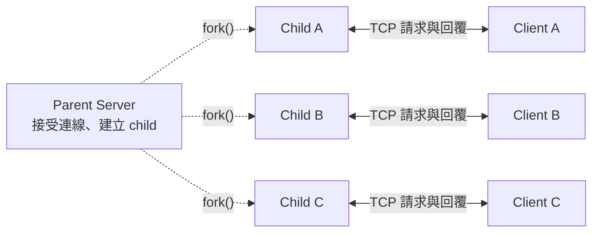

# Network and System Programming Midterm

這個專案是一個以 C 實作的 **fork-per-client 系統資訊服務**。Server 接受 TCP 連線後，會為每一個 client 呼叫 `fork()` 建立獨立 child process；client 可以測試連線、查詢 server 所在電腦的系統資訊，或要求延遲回覆來證明多個 client 確實並行執行。

專案直接使用本機 `gcc`/Apple Clang 與 Makefile，不需要 Docker。macOS 和 Linux 使用相同原始碼；Makefile 會依作業系統選擇正確的動態函式庫參數。

## 1. 作業需求對照

| 作業需求 | 本專案的做法 | 證明方式 |
|---|---|---|
| 每個 client 使用一個 fork child | Parent 在每次 `accept()` 後呼叫 `fork()` | Server log 與 `ps` 顯示不同 PID |
| 至少 10 個 clients 並行 | 10 個 clients 同時執行 `DELAY 3` | `make concurrency-test` |
| 編譯期 debug 控制 | `ENABLE_DEBUG` macro | `make release` / `make debug` |
| 執行期 debug 控制 | `--log-level error\|info\|debug` | 切換 server/client 參數 |
| 動態共用函式庫 | `libnetutil.so` | macOS 用 `otool -L`；Linux 用 `ldd` |
| Client 查詢系統資訊 | `sysinfo` command | hostname、OS、kernel、CPU、memory 等 |
| Robustness | 完整 I/O、timeout、signal、輸入驗證等 | `make robustness-test` |
| 至少三組有／無 robustness 比較 | Fragment、timeout、zombie | `server_baseline` 對照正式 server |
| Makefile | 跨 macOS/Linux 的 Makefile | `make`、`make debug`、`make test` |

影片目前尚未製作；實際封包擷取也先保留到之後用 Wireshark 完成。

## 2. 系統架構



虛線表示 parent 透過 `fork()` 建立 child process；雙向實線表示各 client 與負責服務它的 child 進行 TCP 資料收送。

每個 client 先由 parent 的 `accept()` 接受連線，再呼叫 `fork()`。Child 會繼承已連線的 socket，因此 client 不需要重新連線。Parent 關閉自己那份 client socket，繼續接受其他連線；後續請求與回覆由 child 處理。

Parent process 只負責：

1. 建立 listening socket。
2. `accept()` 新連線。
3. `fork()` child。
4. 關閉 parent 不需要的 client socket。
5. 繼續接受下一個 client。
6. 透過 `SIGCHLD` handler 與 `waitpid(..., WNOHANG)` 回收結束的 child。

Child process 負責：

1. 關閉不需要的 listening socket。
2. 設定 client socket timeout。
3. 接收並驗證一筆 request。
4. 執行對應功能並傳送 response。
5. 關閉連線並以 `_exit()` 結束。

每個 connection 處理一筆 request。這讓 child 的生命週期清楚，也方便觀察 process concurrency。

## 3. 目錄與程式碼說明

```text
midterm/
├── Makefile
├── README.md
├── include/
│   ├── netutil.h          # 網路 I/O、timeout、log 與參數工具 API
│   └── protocol.h         # Request/response 訊息格式 API
├── src/
│   ├── netutil.c          # send_all、recv_line、recv_exact、debug log
│   ├── protocol.c         # command parsing 與 length-prefixed framing
│   ├── server.c           # socket、fork、signal、system information
│   └── client.c           # client CLI、連線與測試模式
├── tests/
│   ├── concurrency_test.sh
│   ├── robustness_demo.sh      # 依序執行以下三組測試
│   ├── robustness_fragment.sh  # TCP request 分段
│   ├── robustness_timeout.sh   # Idle client timeout
│   ├── robustness_zombie.sh    # Zombie process 回收
│   └── test_logging.sh         # 終端機與測試 log 的共用輸出工具
└── docs/
    └── requirements.md         # 完整作業要求
```

編譯後會產生：

```text
build/release/bin/server
build/release/bin/server_baseline
build/release/bin/client
build/release/lib/libnetutil.so

build/debug/bin/server
build/debug/bin/server_baseline
build/debug/bin/client
build/debug/lib/libnetutil.so
```

`netutil.c` 和 `protocol.c` 被編譯成動態函式庫，client 和兩個 server 都連結同一個 `libnetutil.so`。Server/client 沒有複製共用的封包收送、protocol parsing 或 logging 程式碼。

## 4. 支援功能

### `ping`

確認連線與 protocol 正常：

```text
Request:  REQUEST PING\n
Response: OK 5\nPONG\n
```

### `sysinfo`

取得 server 電腦的：

- hostname
- OS 名稱
- kernel version
- CPU architecture
- online CPU 數量
- 總記憶體 MiB
- uptime seconds
- server local time
- 處理 request 的 child PID

### `delay N`

Child 等待 `N` 秒後回覆，`N` 必須介於 0 到 10。這個 command 是 10-client concurrency proof 使用的測試功能。

## 5. 訊息格式

請求以 `REQUEST` 開頭，後面接要執行的指令，整筆訊息寫在同一行：

```text
REQUEST PING\n
REQUEST SYSINFO\n
REQUEST DELAY 3\n
```

成功 response：

```text
OK <payload_bytes>\n
<payload>
```

錯誤 response：

```text
ERR <status_code> <payload_bytes>\n
<error_message>
```

例如：

```text
ERR 400 16\n
invalid request\n
```

Length prefix 很重要，因為 TCP 是 byte stream，不保證一次 `read()` 就對應一個完整封包。Client 先讀 header，再根據長度完整接收 payload。

## 6. 環境需求

- macOS 或 Linux
- `gcc`、`clang` 或相容 C compiler
- `make`
- POSIX socket、`fork()` 與 signal API

目前這台 Mac 的 `/usr/bin/gcc` 實際上是 Apple Clang，仍然可以正常編譯本專案。

## 7. 編譯方式

先進入專案：

```bash
cd midterm
```

編譯正式 release 版本：

```bash
make
make baseline
```

也可以用一個 command 同時建置正式版、client 與 baseline：

```bash
make release
```

編譯含有 debug log 程式碼的版本：

```bash
make debug
```

查看 Makefile 偵測到的設定：

```bash
make print-config
```

移除所有 build artifacts：

```bash
make clean
```

### macOS 與 Linux 的 `.so` 差異

- macOS 使用 `-dynamiclib`，產出名稱為 `libnetutil.so` 的 Mach-O dynamic library。
- Linux 使用 `-shared -fPIC`，產出 ELF shared object。
- 兩個平台都設定相對 rpath，因此不需要手動設定 `DYLD_LIBRARY_PATH` 或 `LD_LIBRARY_PATH`。

## 8. 基本執行方式

開啟第一個 Terminal，啟動 server：

```bash
cd midterm
./build/release/bin/server
```

預設監聽：

```text
127.0.0.1:9090
```

開啟第二個 Terminal，執行 client：

```bash
cd midterm
./build/release/bin/client ping
./build/release/bin/client sysinfo
./build/release/bin/client delay 3
```

實際 `sysinfo` 輸出範例：

```text
hostname: Yn-MacBook-Air.local
os: Darwin
kernel: 27.0.0
architecture: arm64
cpu_online: 10
memory_total_mib: 24576
uptime_seconds: 2534393
server_time: 2026-11-06 19:42:54 +0800
child_pid: 34477
```

按 `Ctrl+C` 可讓 parent server 正常停止。

### 自訂 host 與 port

Server：

```bash
./build/release/bin/server --bind 127.0.0.1 --port 10000
```

Client：

```bash
./build/release/bin/client --host 127.0.0.1 --port 10000 sysinfo
```

### 兩台電腦連線

Server 必須監聽所有 IPv4 interfaces：

```bash
./build/release/bin/server --bind 0.0.0.0 --port 9090
```

另一台電腦以 server 的區域網路 IP 連線：

```bash
./build/release/bin/client --host 192.168.1.10 --port 9090 sysinfo
```

請確認兩台電腦位於可互通的網路，且防火牆允許 TCP 9090。

## 9. 兩層 Debug Log 控制

### Release 與 Debug 比較

兩種版本都提供相同的程式功能。Debug 適合開發與除錯；Release 則開啟編譯器最佳化。

| 比較項目 | **Release（`release`）** | **Debug（`debug`）** |
|---|---|---|
| 建置指令 | `make release` | `make debug` |
| 輸出目錄 | `build/release/` | `build/debug/` |
| Server 執行路徑 | `./build/release/bin/server` | `./build/debug/bin/server` |
| Client 執行路徑 | `./build/release/bin/client` | `./build/debug/bin/client` |
| 編譯參數 | `-O2`：開啟最佳化 | `-O0 -g3`：關閉最佳化、保留除錯資訊 |
| `ENABLE_DEBUG` macro | 不定義 | 透過 `-DENABLE_DEBUG` 定義 |
| `NET_LOG_DEBUG(...)` | 編譯時移除 | 保留，由執行期 log 等級決定是否顯示 |
| `--log-level debug` | 顯示 INFO、ERROR；DEBUG 呼叫已移除 | 顯示 DEBUG、INFO、ERROR |
| 正式 `server` 的 robustness 保護 | 開啟 | 開啟 |

建置版本和執行期 log 等級是兩件事：編譯期決定「有沒有 DEBUG log 程式碼」，執行期決定「顯示哪些已編入的訊息」。`server_baseline` 則是另一個關閉部分保護的示範程式，也可以分別建置成 Release 或 Debug。

### 第一層：編譯期

**Release（`build/release/`）**：編譯時移除 DEBUG log 呼叫。

```bash
make release
./build/release/bin/server --log-level debug
```

Server 會顯示：

```text
compile-time debug=disabled
```

即使 runtime 指定 `debug`，`NET_LOG_DEBUG(...)` 已在 preprocessor 階段變成 no-op，debug 訊息不會被編入有效執行路徑。

**Debug（`build/debug/`）**：保留 DEBUG log 呼叫。

```bash
make debug
./build/debug/bin/server --log-level debug
```

Server 會顯示：

```text
compile-time debug=enabled
```

並輸出 request、fork child PID 等詳細訊息。

### 第二層：執行期

以下指令皆使用 **Debug 版本**，只改變執行期 log 等級。一次執行一個 server，以 `Ctrl+C` 停止後再執行下一個。

```bash
./build/debug/bin/server --log-level error
./build/debug/bin/server --log-level info
./build/debug/bin/server --log-level debug
```

- `error`：只顯示錯誤。
- `info`：顯示啟動、client、timeout、shutdown 等資訊。
- `debug`：使用 Debug 版本時，再加上 request 內容與 fork 詳情。

Client 也支援相同的 `--log-level` 參數。

## 10. 證明動態函式庫連結

macOS：

```bash
file build/release/lib/libnetutil.so
otool -L build/release/bin/server
otool -L build/release/bin/client
```

預期 server/client 都會出現：

```text
@rpath/libnetutil.so
```

Linux：

```bash
file build/release/lib/libnetutil.so
ldd build/release/bin/server
ldd build/release/bin/client
```

預期兩邊都會列出 `libnetutil.so`。

## 11. 10 Clients 並行執行證明

執行：

```bash
make concurrency-test
```

測試會自動：

1. 在 `127.0.0.1:19090` 啟動正式 server。
2. 同時建立 10 個 clients。
3. 每個 client 發送 `DELAY 3`。
4. 在執行期間以 `ps` 記錄 child process。
5. 檢查至少同時存在 10 個 child。
6. 檢查總時間不超過 8 秒。

本機實際驗證結果：

```text
Observed live server child processes: 10
Elapsed time: 3s (serial execution would take about 30s)
PASS: at least 10 clients were handled concurrently by separate server children.
```

證據檔案保存在：

```text
build/release/test-output/concurrency/
├── test.log
├── server.log
├── child-processes.txt
└── client-1.log ... client-10.log
```

報告截圖時建議同時截到：10 筆 child PID、elapsed time 與最後的 PASS。

這份 process 清單顯示的是 **server 的 child processes，不是 client processes**。欄位標題為 `PPID / STATE / PID / COMMAND`：`PPID` 是 parent server 的 PID，每個不同的 `PID` 則代表一個 child；`S` 表示執行 `DELAY 3` 時正在休眠或等待。這些說明與欄位標題會一起寫進 `test.log` 與 `child-processes.txt`。Client 回覆另外保存在 `client-1.log` 到 `client-10.log`。

## 12. Robustness 設計

正式 server 實作以下機制：

- 檢查 `socket()`、`bind()`、`listen()`、`accept()`、`fork()` 等回傳值。
- `net_send_all()` 處理 partial write。
- `net_recv_line()` 處理 partial read 與 TCP fragmentation。
- `net_recv_exact()` 根據 payload length 接收完整內容。
- 收到 `EINTR` 時安全地重新嘗試 I/O。
- Request 上限為 1023 bytes；payload 上限為 8192 bytes。
- 驗證 port、timeout、command 與 delay range。
- Client socket 預設 5 秒 read/write timeout。
- 忽略 `SIGPIPE`，client 突然斷線不會殺死 server process。
- `SIGCHLD` handler 呼叫 `waitpid(-1, NULL, WNOHANG)` 回收 children。
- Parent 與 child 關閉各自不需要的 file descriptor。
- `SIGINT`/`SIGTERM` 讓 parent graceful shutdown。
- `SO_REUSEADDR` 降低重新啟動時遇到 address already in use 的機會。
- 不執行 client 提供的 shell command，因此不會產生命令注入。

## 13. 三組有／無 Robustness 比較

建置並執行全部比較：

```bash
make robustness-test
```

三組比較已拆成獨立腳本，方便逐一閱讀、執行與截圖。可以分別執行：

```bash
make fragment-test    # TCP request 分段
make timeout-test     # Idle client timeout
make zombie-test      # Zombie process 回收
```

Makefile 會先建置所需程式。若已執行 `make demos`，也可以直接使用腳本：

```bash
sh tests/robustness_fragment.sh release
sh tests/robustness_timeout.sh release
sh tests/robustness_zombie.sh release
```

執行 debug 版本可使用 `make DEBUG=1 fragment-test`（其他兩組相同），或將腳本最後的 `release` 改成 `debug`。`robustness_demo.sh` 只負責依序呼叫三個腳本，任一組失敗就停止；原本的 `make robustness-test` 與 `make test` 仍可照常使用。各組測試證據仍存放於 `build/<mode>/test-output/robustness/`。

`server_baseline` 與正式 server 來自同一份 `server.c`，但 baseline 在編譯時定義 `BASELINE_MODE`，刻意關閉以下三項保護：

- 只呼叫一次 `recv()`，不重組 fragmented request。
- 不設定 client timeout。
- 不安裝 `SIGCHLD` child reaper。

Baseline 仍保留固定大小 buffer 和基本參數檢查，不以 buffer overflow 等危險漏洞作展示，也不應當作正式 server 使用。

### 範例一：TCP fragmented request

Client 每隔 50 ms 只傳送一個 byte：

```bash
./build/release/bin/client --port PORT --fragment-delay-ms 50 sysinfo
```

- Baseline：第一次 `recv()` 只取得 `R`，把 request 判定為錯誤並提早關閉；client 得到 `Broken pipe`。
- Robust：`net_recv_line()` 持續接收至 newline，成功組合 `REQUEST SYSINFO`。

本機結果：

```text
baseline exit status: 1
robust exit status:   0
PASS: robust recv_line() reconstructed the split request.
```

### 範例二：Idle client timeout

`--sleep-no-request SECONDS` 表示連線後不送請求，休眠指定秒數再關閉連線。例如休眠四秒：

```bash
./build/release/bin/client --port PORT --sleep-no-request 4
```

測試 server timeout 設為兩秒：

- Baseline：三秒後 child 仍然卡在 `recv()`。
- Robust：兩秒後回覆 408 timeout、關閉連線並結束 child。

本機結果：

```text
baseline live children after 3s: 1
robust live children after 3s:   0
PASS: the robust server released the idle child after 2s.
```

### 範例三：Zombie process

測試連續建立八個短連線：

- Baseline：child 結束後 parent 沒有 `wait()`，留下八個 `<defunct>` processes。
- Robust：`SIGCHLD` handler 立即以 `waitpid(..., WNOHANG)` 回收。

本機結果：

```text
baseline zombie children: 8
robust zombie children:   0
PASS: SIGCHLD + waitpid(WNOHANG) prevented zombies.
```

所有輸出與 process snapshots 保存在：

```text
build/release/test-output/robustness/
```

一次執行所有測試：

```bash
make test
```

### 測試項目、進度與 Log

每個測試都會顯示測試名稱（`[TEST]`）、預期行為（`[EXPECT]`）、步驟進度（`[1/5]` 到 `[5/5]`），以及最後的 `PASS` 或 `FAIL`。Zombie 測試還會逐一顯示 PING client 完成數（`1/8` 到 `8/8`）。Robustness 整合入口標示三個測試項目的 `[1/3]` 到 `[3/3]`；`make test` 則標示兩個測試階段的 `[TEST SUITE 1/2]` 與 `[TEST SUITE 2/2]`。

進度與結果會同時顯示在終端機，並存入 `build/<mode>/test-output/`：

| Log | 內容 |
|---|---|
| `concurrency/test.log` | 並行測試名稱、預期行為、步驟、server child 清單、耗時與結果 |
| `robustness/fragment-test.log` | 封包分段測試進度與 baseline/robust 結果 |
| `robustness/timeout-test.log` | 不送請求的 timeout 測試進度與存活 child 數量 |
| `robustness/zombie-test.log` | Zombie 測試進度、PING 完成數與 zombie 數量 |
| `robustness/suite.log` | 三項 robustness 比較的項目名稱、順序與通過／失敗結果 |

上述 log 每次執行都會重新記錄。Server/client 各自的原始 log 另外保留，方便區分「測試進度」與「程式實際訊息」。

## 14. Wireshark 擷取規劃

作業文字指定 loopback 可用 tcpdump、不同電腦可用 Wireshark。若要完全貼合作業敘述，建議最後用兩台電腦執行，並以 Wireshark 擷取實體網路介面。

### 兩台電腦

1. Server 執行：

   ```bash
   ./build/release/bin/server --bind 0.0.0.0 --port 9090
   ```

2. Wireshark 選擇 Wi-Fi/Ethernet interface，例如 macOS 常見的 `en0`。
3. Capture filter：

   ```text
   tcp port 9090
   ```

4. 另一台電腦執行 client。
5. 停止擷取後使用 display filter：

   ```text
   tcp.port == 9090
   ```

### 同一台 Mac

Wireshark 技術上也能擷取 loopback：選擇 `lo0`，使用相同 filter。不過報告中應確認老師是否接受以 Wireshark 取代題目所寫的 loopback tcpdump。

建議分析與截圖：

- TCP three-way handshake：SYN、SYN/ACK、ACK。
- Client 的 `REQUEST SYSINFO` request。
- Server 的 `OK <length>` 與 system-information payload。
- Sequence number 與 acknowledgment number。
- Client/server IP 與 TCP port。
- FIN/ACK connection termination。

## 15. 報告與現場展示建議順序

1. 顯示目錄與架構圖。
2. `make release`，說明 Makefile 與 `.so`。
3. `otool -L` 或 `ldd` 證明兩個 executable 都連結共用函式庫。
4. 啟動 server，分別執行 `ping`、`sysinfo`。
5. 執行 release/debug 與不同 runtime log level。
6. 執行 `make concurrency-test`，截下 10 child PIDs 與三秒結果。
7. 執行 `make robustness-test`，截下三組 PASS。
8. 展示 Wireshark request/response 與 TCP handshake。

報告至少保留下列 screenshots：

- Release 與 debug log 差異。
- `otool -L`/`ldd` 的 `libnetutil.so` linkage。
- `sysinfo` response。
- 10 clients concurrent proof。
- Fragmented-request baseline/robust comparison。
- Timeout baseline/robust comparison。
- Zombie baseline/robust comparison。
- Wireshark packet analysis。

## 16. 常見問題

### `Address already in use`

確認沒有舊 server：

```bash
lsof -nP -iTCP:9090 -sTCP:LISTEN
```

關閉舊 server，或改用其他 port。

### `Connection refused`

確認：

- Server 已啟動。
- Client 與 server 使用相同 port。
- 跨電腦時 server 使用 `--bind 0.0.0.0`。
- Host IP 正確且防火牆允許連線。

### 找不到 `libnetutil.so`

請從 Makefile 建置，不要只單獨編譯一個 `.c`：

```bash
make release
```

Makefile 已設定相對 rpath。請保留 `bin/` 與 `lib/` 在同一個 build mode 目錄下，不要只移動 executable。

### 如何修改預設 port

不需要改原始碼，server/client 都使用 `--port`：

```bash
./build/release/bin/server --port 12345
./build/release/bin/client --port 12345 sysinfo
```

## 17. 已驗證狀態

以下項目已在 macOS ARM 上實際驗證：

- Release build：成功且無 compiler warning。
- Debug build：成功且無 compiler warning。
- `ping`、`sysinfo`、`delay`：成功。
- `libnetutil.so`：server/client 的 `otool -L` 都顯示 `@rpath/libnetutil.so`。
- 10 clients：同時觀察到 10 個 child，約 3 秒完成。
- Fragmented request：baseline 失敗，robust 成功。
- Idle timeout：baseline 留下 child，robust 正常釋放。
- Zombie process：baseline 8 個，robust 0 個。

Linux 使用相同 source code 與 Makefile；提交前若能在學校 Linux 主機再執行一次 `make test`，即可同時取得 ELF `.so` 與 Linux 執行截圖。
